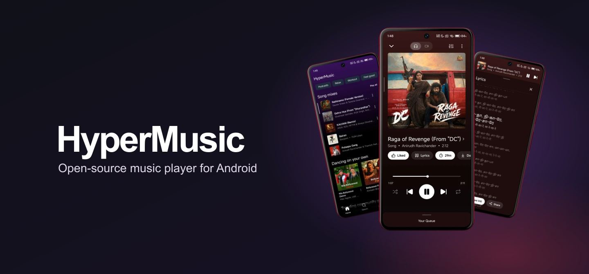

<div align="center">



# HyperMusic

A modern, privacy-focused, native Android music streaming and local playback client.

[](LICENSE)
[-success.svg?style=flat-square)](https://developer.android.com)
[](https://kotlinlang.org)
[](https://developer.android.com/jetpack/compose)

[GitHub Releases](https://github.com/SachinYedav/hypermusic/releases) · [Features](#features) · [Build from Source](#build-from-source) · [Website](web/README.md) · [Privacy](#privacy--transparency) · [Disclaimer](#disclaimer)

</div>

---

## Overview

**HyperMusic** is an open-source Android music app. Built with **Kotlin**, **Jetpack Compose**, **AndroidX Media3 (ExoPlayer)**, and **Room Database**, it combines music streaming, library management, offline downloads and local audio playback, with no in-app ads.

---

## Features

### Playback & Audio
- **No In-App Ads** — No banner ads, advertising pop-ups or app-inserted commercials.
- **Configurable Audio Tiers** — Select between Data Saver, Standard (~128 kbps), and High quality profiles for streaming and downloads, dynamically matched against source Opus and AAC streams.
- **Podcasts & Video Switching** — Listen to podcasts and switch to video for supported content. Video playback prefers progressive MP4 streams at 360p/480p with audio, rather than high-resolution video-only streams.
- **Audio Effects** — Built-in multi-band equalizer with Bass Boost and Virtualizer, utilizing native Android audio effects where supported by your device hardware.
- **Sleep Timer** — Stop playback after 15, 30, 45 or 60 minutes, or at the end of the current track.

### Lyrics & Interface
- **Synchronized Lyrics** — Line-synced lyrics with auto-scrolling and plain-text fallback when available. Lyrics lookups use LRCLIB with YouTube fallback; lyric translation uses Google Translate.
- **Themes & Player Colors** — Light and dark themes, artwork-driven player glows, and Android 13+ themed launcher icons where supported and enabled by the launcher.
- **Home Screen Widgets** — Four distinct Android home-screen widget variants (Search & Play, Capsule, Recommended, and Large Player) for immediate playback control.
- **Launcher Quick Actions** — App icon shortcuts for instant one-tap navigation to Search, Playlists, Liked Songs, and History.

### Library & Offline
- **Background Downloads** — Offline downloads with background queue processing powered by Android WorkManager.
- **Local Audio Playback** — Scan, browse, and play on-device audio files stored in your device's music folders directly within the app.
- **Comprehensive Library Management** — Create and organize playlists, manage favorite tracks, explore listening history, and reorder playback queues.
- **Storage & Cache Control** — Inspect storage usage and clear cache, listening history or downloaded tracks from the storage manager.

---

## Tech Stack

| Component | Technology | Role & Purpose |
| :--- | :--- | :--- |
| **Language & Concurrency** | Kotlin 2.0+, Coroutines, StateFlow | Modern reactive programming and lifecycle-aware asynchronous streams |
| **UI Framework** | Jetpack Compose & Material 3 | Declarative UI, light/dark themes and artwork-driven player colors |
| **Audio Engine** | AndroidX Media3 (ExoPlayer) | Audio/video playback, queue orchestration, caching, and MediaSession integration |
| **Local Persistence** | Room Database & DataStore | Relational database for tracks/playlists/history and persistent user preferences |
| **Background Processing** | AndroidX WorkManager | Background audio download management and queue workers |
| **Dependency Injection** | Koin | Lightweight, reflection-free dependency injection |
| **Catalog & Streaming** | Custom InnerTube & NewPipeExtractor | Direct catalog browse/search extraction and stream URL resolution |
| **Networking** | OkHttp 4.12.0 & HttpURLConnection | Media and lyrics requests, and update checks through the GitHub release feed |
| **Image Loading** | Coil Compose | Asynchronous image loading with memory and disk caching for artwork |

---

## Build from Source

### Prerequisites
- **JDK 17** (Temurin, OpenJDK, or Zulu)
- **Android SDK** with Platform `API 35` and Build Tools installed
- Android Studio or a command-line Android SDK setup; use the included Gradle wrapper
- A device or emulator running Android 8.0+ (API 26+) to run the app, not to assemble it

Accept the Android SDK licenses before building. The first build needs internet access to download dependencies.

### Build Steps

1. **Clone the repository:**
   ```bash
   git clone https://github.com/SachinYedav/hypermusic.git
   cd hypermusic
   ```

2. **Configure SDK location:**
   Ensure a `local.properties` file exists in the project root with your Android SDK path:
   ```properties
   # Windows example
   sdk.dir=C:/Users/your-username/AppData/Local/Android/Sdk
   # macOS alternative
   # sdk.dir=/Users/your-username/Library/Android/sdk
   # Linux alternative
   # sdk.dir=/home/your-username/Android/Sdk
   ```

3. **Assemble Debug APK:**
   - **Linux / macOS:**
     ```bash
     chmod +x gradlew
     ./gradlew assembleDebug
     ```
   - **Windows:**
     ```powershell
     .\gradlew.bat assembleDebug
     ```

   The compiled APK will be generated at:
   `app/build/outputs/apk/debug/app-debug.apk`

### Release Signing

Debug builds do not need a private release keystore. For local signed release builds, place the keystore at `app/hypermusic-release.keystore`, configure `RELEASE_KEYSTORE_PASSWORD`, `RELEASE_KEY_PASSWORD` and `RELEASE_KEY_ALIAS` in your local `local.properties`, then run `assembleRelease`. Keep signing files and credentials private.

The release build produces one signed `app-release.apk` in `app/build/outputs/apk/release/`. It includes ARM64, ARMv7, x86, and x86-64 native libraries.

The Android project lives at the repository root. See the [website README](web/README.md) for local setup, static builds, and release data.

---

## Privacy & Transparency

- **Local Data Storage** — Playlists, listening history, favorites and settings are stored locally using Room and DataStore. HyperMusic has no user accounts or app-managed library cloud sync.
- **Android System Backup** — Android backup is enabled (`android:allowBackup="true"`). Eligible app data may be backed up and restored depending on device settings and platform behavior; transfer is not guaranteed.
- **App Analytics** — HyperMusic does not integrate an app analytics or advertising SDK. External services handle requests according to their own policies.
- **External Network Endpoints**:
  - **YouTube Music / InnerTube:** Required to query search suggestions, song catalogs, radio queues, artist metadata, and media audio/video streams.
  - **LRCLIB:** Queried using song metadata, including title, artist and duration, to fetch synchronized or plain-text lyrics.
  - **Google Translate:** Receives lyrics text when lyric translation is requested.
  - **GitHub:** The app reads the project's [release feed](public/releases.json) to check for updates.
  - **Artwork servers:** Contacted to load cover art and artist images.
- **Availability** — Streaming requires internet access. Content, lyrics and quality depend on source availability and region; upstream service changes or network failures can affect playback.
- **Content Sponsorships** — Streaming content originates directly from upstream providers. HyperMusic does not alter or filter creator-embedded video sponsorships.

---

## Disclaimer

HyperMusic is an independently maintained open-source project.

- This application is **not** affiliated with, endorsed by, or sponsored by Google LLC, YouTube, or YouTube Music.
- YouTube and YouTube Music are registered trademarks of Google LLC.
- Online media and metadata are retrieved from third-party services; local audio is read from your device. InnerTube integration is not an official YouTube API partnership.
- Availability of content does not grant ownership or permission to redistribute it. See [LICENSE](LICENSE) for the software license and warranty terms.

---

## Acknowledgements & Credits

HyperMusic is built upon the invaluable contributions of the open-source community:

- **[Team NewPipe](https://github.com/TeamNewPipe/NewPipeExtractor)** — For the `NewPipeExtractor` engine powering YouTube stream resolution under the GNU GPLv3 license.
- **[LRCLIB](https://lrclib.net)** — For the public lyric database powering synchronized lyrics.
- **[Lucide Icons](https://lucide.dev)** — For the clean and consistent icon set powering the application's UI under the ISC License (with Feather-derived icons under MIT).
- **Library Authors** — For Jetpack Compose, Media3, Koin, Coil, OkHttp, Room and other dependencies. Dependency license information is available inside the app under **Settings → About → Open Source Licenses**.

---

## License

This project is licensed under the **GNU General Public License, version 3 or later** (GPL-3.0-or-later).
See the [LICENSE](LICENSE) file for the full license text.

```text
Copyright (C) 2026 Sachin Yedav

This program is free software: you can redistribute it and/or modify
it under the terms of the GNU General Public License as published by
the Free Software Foundation, either version 3 of the License, or
(at your option) any later version.
```
